# powerPlus — SI 실무자의 올인원 플랫폼

> 제안서 에셋, 장표 변환, 홈페이지 목업, 디자인 규칙을 로그인 한 번으로 씁니다.
> 어느 화면에서든 챗봇에 말로 시키면 되고, 외부 AI 도구에서는 MCP 하나로 같은 기능을 부릅니다.

| 데모 | 주소 |
|:---:|---|
| 서비스 | https://powerplus.hom2box.com |
| 관리자 | https://powerplus.hom2box.com/admin |
| MCP 연결 가이드 | https://powerplus.hom2box.com/docs |
| 상태 확인(API) | https://powerplus.hom2box.com/api/v1/health |

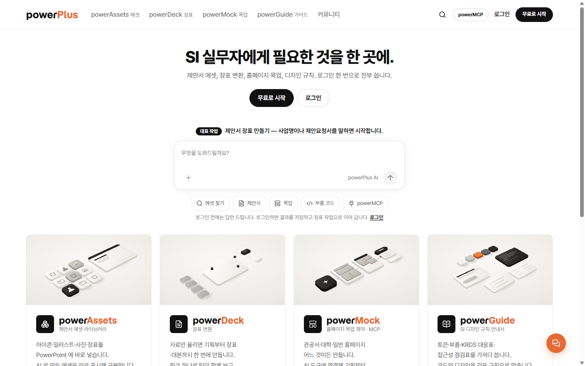

---

## 목차
1. [왜 만들었나](#1-왜-만들었나)
2. [다섯 개 모듈](#2-다섯-개-모듈)
3. [핵심 장점 — 말로 시키는 플랫폼](#3-핵심-장점--말로-시키는-플랫폼)
4. [AI 활용 구조](#4-ai-활용-구조)
5. [화면](#5-화면)
6. [관리자](#6-관리자)
7. [심사용 테스트 계정](#7-심사용-테스트-계정)
8. [기술 스택](#8-기술-스택)
9. [시스템 구조](#9-시스템-구조)
10. [폴더 구조](#10-폴더-구조)
11. [로컬 실행](#11-로컬-실행)
12. [공개본 안내](#12-공개본-안내)
13. [라이선스](#13-라이선스)

---

## 1. 왜 만들었나

SI 제안·구축 실무는 같은 일을 매번 처음부터 합니다.

- 제안서 장표에 넣을 아이콘·사진을 찾느라 시간을 씁니다.
- 여러 사람이 만든 장표의 서체·색·여백이 제각각입니다.
- 공공기관 홈페이지 목업을 만들 때마다 레퍼런스를 다시 모읍니다.
- 디자인 규칙과 접근성(KRDS·KWCAG) 기준이 문서마다 흩어져 있습니다.

powerPlus 는 흩어져 있던 사내 도구 네 개를 한 플랫폼으로 합쳤습니다.
계정·권한·공개 범위를 하나로 묶었고, 같은 기능을 웹 화면·PowerPoint 애드인·MCP 세 곳에서 씁니다.

## 2. 다섯 개 모듈

| 모듈 | 하는 일 | 주소 |
|:---:|---|:---:|
| **powerAssets** | 아이콘·일러스트·사진·장표 에셋 라이브러리. 검색, 같은 톤 세트 추천, PowerPoint 애드인으로 바로 삽입 | `/assets` |
| **powerDeck** | 자료(pptx·문서)를 올리면 기획 → 와이어프레임 → 시안 → 장표 제작 → 발표 대본까지 한 흐름으로 진행 | `/deck` |
| **powerMock** | 국내 공공·대학 홈페이지 실제 화면에서 뽑은 레퍼런스로 홈페이지 목업과 화면 코드를 만듦 | `/mock` |
| **powerGuide** | 디자인 토큰·React/Vue 부품·KRDS 대응표·접근성 점검표를 한 곳에서 제공 | `/guide` |
| **powerMCP** | 위 네 모듈을 외부 AI 도구에서 부르는 MCP 서버 하나(도구 47개, 키 하나) | `/powermcp` |

모든 콘텐츠에는 공개 범위가 붙습니다(사내 전용 → 파트너 → 유료 → 무료 → 공개).
화면에서 숨기는 것이 아니라 서버가 한 함수(`Access::can()`)로 판정합니다.

## 3. 핵심 장점 — 말로 시키는 플랫폼

### 메인과 서브, 어느 화면에서든 챗봇으로 바로 지시
- **메인 화면**에는 큰 입력창(powerPlus AI)이 있습니다.
  "제안서 표지에 어울리는 파란 톤 보안 아이콘 찾아줘"처럼 말하면 결과 카드가 바로 나옵니다.
- **모든 서브 화면**에는 오른쪽 아래 떠 있는 AI 버튼이 있습니다.
  메뉴를 찾아 들어가지 않아도 지금 보는 화면에서 바로 묻고 시킵니다.
- **대화는 화면을 옮겨도 이어집니다.**
  메인에서 아이콘을 찾고, powerGuide 화면으로 가서 "이 화면에 맞는 KRDS 부품 알려줘"라고 이어 말할 수 있습니다.
- **어느 모듈에 시킬지 사람이 고르지 않습니다.**
  챗봇이 말의 의도를 판정해 powerAssets·powerDeck·powerMock·powerGuide·도움말 중 맞는 곳으로 보냅니다.
- **제안서는 사업명 한 줄로 시작합니다.**
  사업명이나 제안요청서를 말하면 powerDeck 장표 작업이 만들어지고, 같은 대화 안에서 기획 → 시안 단계를 이어 갑니다.
- **로그인 전에도 써 볼 수 있습니다.** 비회원은 답까지만 받고, 로그인하면 결과를 저장하고 장표 작업으로 이어 갑니다.

| 메인 — 말 한 줄로 에셋 찾기 | 서브 — 떠 있는 AI 버튼, 대화가 이어짐 |
|:---:|:---:|
| 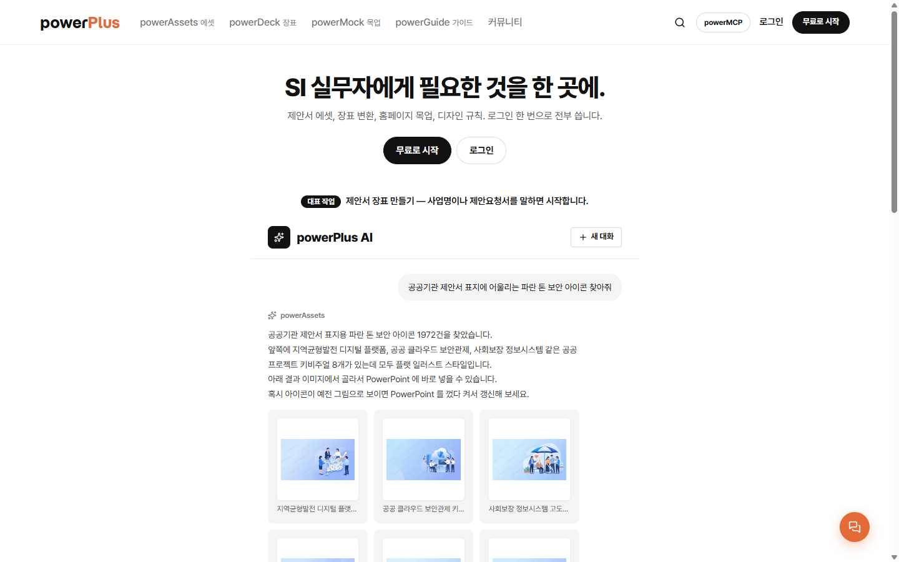 | 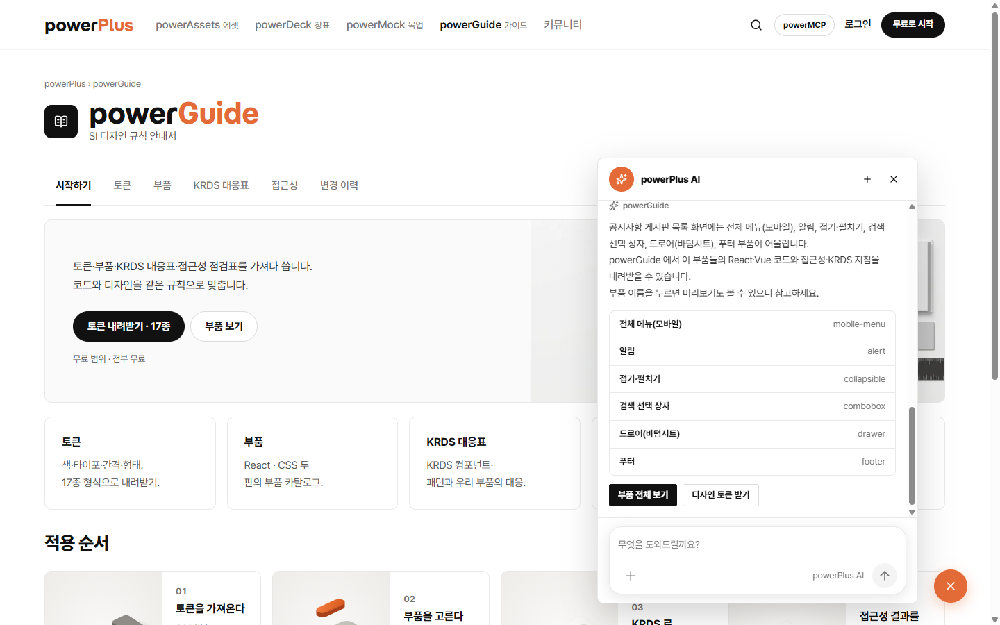 |

### 한 계정으로 세 입구
| 입구 | 쓰는 사람 | 하는 일 |
|:---:|---|---|
| 웹 | 기획자·디자이너·퍼블리셔 | 모든 모듈, 챗봇, 관리자 |
| PowerPoint 애드인 | 제안서 작성자 | 작업창에서 에셋 검색·삽입, 슬라이드 글에 맞는 에셋 추천 |
| powerMCP | Claude·ChatGPT·Cursor 사용자 | AI 도구 안에서 에셋 검색, 목업 제작·판정, 장표 재료, 디자인 규칙 조회 |

### AI 가 만들고, 규칙이 검사합니다
AI 결과는 그대로 내보내지 않습니다. 사람이 정한 규칙이 다시 재고, 기준에 못 미치면 고치거나 버립니다(4.5절).

## 4. AI 활용 구조

### 4.1 원칙
1. **외부 AI 창구는 OpenRouter 하나** — 키는 서버만 갖고, 엔진·챗봇·애드인의 호출은 모두 서버를 거칩니다. 호출마다 비용이 기록됩니다.
2. **모델은 코드가 아니라 관리자 설정으로 바꿉니다** — `/admin/ai` 와 장표 설정에서 모델·추론 강도·하루 상한을 고칩니다. 배포 없이 바로 바뀝니다.
3. **AI 는 보조, 규칙이 바닥** — 판단 AI 가 꺼져 있거나, 한도를 넘었거나, 확신이 낮으면 원래 규칙으로 계속합니다. AI 가 없어도 서비스는 멈추지 않습니다.
4. **재료는 우리가, 작업은 사용자 AI 가** — powerMCP 는 스스로 LLM 을 거의 부르지 않습니다. 외부 AI 에 레퍼런스·규칙·판정을 주고, 결과물은 사용자 AI 가 만듭니다.

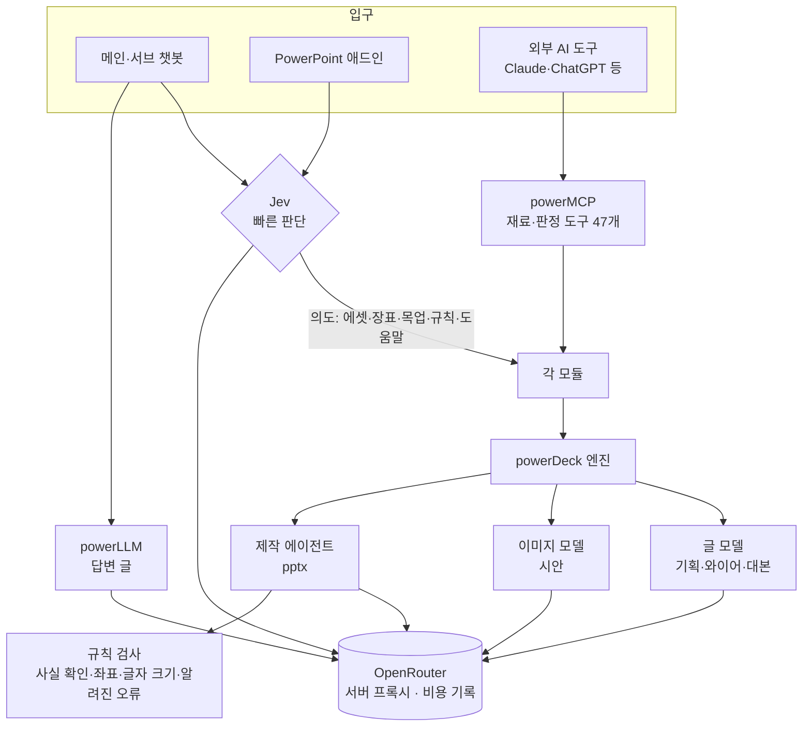

### 4.2 모델 구성

| 용도 | 지금 쓰는 모델 | 정식 운영 | 바꾸는 곳 |
|:---:|---|---|:---:|
| powerDeck 글 작업(자료 요약·기획·와이어·대본) | Meta **Muse Spark 1.3**(추론 xhigh) | **Claude Opus 5.5** 로 전환 | 장표 설정 |
| powerDeck 장표 제작 에이전트(pptx) | Claude Opus 5.5 | Claude Opus 5.5 | 장표 설정 |
| powerDeck 시안 이미지 | OpenAI gpt-image-2.5-flare | 같음 | 장표 설정 |
| 표지·간지 실사 배경 | Google Gemini 3.1 Flash Image | 같음 | 스타일 설정 |
| 챗봇 답변 글(powerLLM) | Claude Haiku 4.5 | 검토 후 결정 | `/admin/ai` |
| 빠른 판단(Jev) | typesafe/jev-1.13 | 같음 | 켜기·끄기·상한만 |

> **Muse Spark 는 개발·시험용입니다.**
> 장표 한 벌을 만드는 데 글 호출이 수십 번 일어나서, 개발 중에는 비용이 아주 낮은 Muse Spark 로 시험하고 있습니다.
> 정식 운영에서는 글 작업 모델을 Claude Opus 5.5 로 바꿉니다. 코드 수정 없이 장표 설정의 모델 칸만 바꾸면 됩니다.

**추론 강도는 작업 종류로 정해집니다** — 자료 요약 low, 기획 xhigh, 제작 high.
생각에 토큰을 다 써서 답이 비는 일을 막으려고, 생각 몫(`reasoning.max_tokens`)과 답 몫을 나눠 잡습니다.
모델이 받지 않는 인자는 OpenRouter 모델 목록(6시간 캐시)을 보고 빼고 보냅니다.

### 4.3 Jev — 빠른 판단 담당

Jev(`typesafe/jev-1.13`)는 **글을 쓰지 않는 판단 전용 모델**입니다.
정해 둔 선택지 중 하나를 고르거나, 점수·예/아니오 확률만 돌려줍니다.
한 번에 약 $0.00002 라서 플랫폼 곳곳의 "고르기"를 맡깁니다.

동작 순서:
1. 넘길 글에서 이메일·전화번호를 지웁니다.
2. 관리자가 켜 두었는지 → 같은 질문을 전에 물었는지(캐시) → 하루 상한 → 키 순서로 확인합니다.
3. 판단을 받아 기록합니다.
4. 확신이 기준 이상이면 그 값을 쓰고, 아니면 원래 규칙으로 계속합니다.

| 사용처 | 하는 일 |
|:---:|---|
| 메인 채팅 의도 | 챗봇에 한 말이 에셋·장표·목업·규칙·도움말·범위 밖 중 무엇인지 고름 |
| AI 도우미 | 질문에 맞는 도움말 문서 하나를 고름(답을 지어내지 않음) |
| 요청 판정 | 플랫폼이 할 수 있는 요청인지 가림(MCP `powerplus_check_request`) |
| 통합 검색 탭 | 검색어에 맞는 결과 탭을 먼저 엶 |
| 장표 아이콘 고르기 | 문장 옆에 놓을 powerAssets 아이콘 하나를 고름(`assets_pick`) |
| 애드인 검색 종류 | 검색어 → 에셋 종류 |
| 애드인 슬라이드 추천 | 슬라이드 글 → 에셋 종류·대표 검색어 |
| 장표 분위기 | 기획의 분위기 값을 정해진 7개 중 가장 가까운 것으로 |
| 자료 요청 종류 | 사용자가 보낸 에셋 요청을 분류 |
| 문의 분류 | 주제·서비스·급함·스팸 |
| 커뮤니티 글 점검 | 광고·비방 확률(숨김은 관리자가 결정) |
| 체크리스트 분야 | 목업 판정에서 나온 고칠 점의 분야 |

사용처마다 관리자 화면에서 따로 끌 수 있습니다.

### 4.4 모듈별 AI 적용

| 모듈 | AI 가 하는 일 | 규칙이 하는 일 |
|:---:|---|---|
| **powerAssets** | 문맥에 맞는 아이콘 고르기(Jev), 애드인 종류·검색어 추천(Jev) | 검색(어미 떼기·오타 교정·동의어 확장·가중 점수), 같은 톤 세트 |
| **powerDeck** | 자료 요약, 기획(개요 → 장별 상세), 와이어 구성, 장별 시안 이미지, pptx 제작 에이전트, 발표 대본 | 사실 확인(자료에 없는 수치·과장), 와이어 좌표 계산·겹침 검사, 글자 크기·정렬 마감, 알려진 오류 자동 보정 |
| **powerMock** | 와이어 "AI 다듬기"(점수가 나빠지면 버림), 고칠 점 분류(Jev) | 레퍼런스 추출, 와이어 초안, 시안 판정(실제 렌더 후 줄·칸·높이·밝기 대조, 캐러셀·탭 동작 확인, 85점 이상 통과) |
| **powerGuide** | — | 코드 점검 `guide_check_code`(결정적 규칙), 토큰·부품·KRDS 제공 |
| **챗봇** | 의도 판정(Jev), 답변 글(powerLLM) | 결과 링크는 서버가 붙임, LLM 이 안 되면 도움말 원문으로 답 |
| **powerMCP** | 사용자 AI 가 결과물을 만듦 | 서버는 재료와 판정만 줌(서버 LLM 거의 0) |

**powerDeck 흐름**

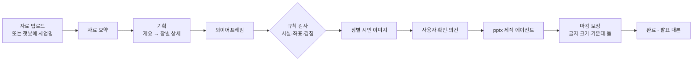

- 장표 엔진은 서버의 작업 대기열에서 일을 끌어가는 방식입니다. 엔진의 모든 AI 호출은 서버 프록시를 거쳐 비용이 작업별로 쌓입니다.
- 한 번 나온 장표 오류는 `engine/known_errors.json` 한 곳에 적습니다. 그 한 줄이 엔진 지침·관리자 개선 체크리스트·회귀 시험 세 곳에 함께 쓰입니다.

### 4.5 비용·한도 장치

| 장치 | 내용 |
|:---:|---|
| 하루 상한 | Jev 기본 $0.5, 챗봇 답변 기본 $3. 넘으면 규칙·도움말 원문으로 내려감 |
| 장표 예산 | 작업당 한도와 사용자별 월 상한. 넘으면 그 자리에서 멈춤 |
| 잔액 확인 | OpenRouter 잔액이 없으면 시안 그림을 막음 |
| 이력·과금 | 모든 호출을 모델·작업·토큰·비용으로 기록, 관리자 화면에서 확인 |
| MCP 호출 한도 | 키별 하루 호출 수, 모든 응답에 남은 횟수 표시 |
| 재시도 | 추론 인자 거절이면 빼고 다시, 시간 초과면 한 번 더, 한도 초과면 즉시 멈춤 |

## 5. 화면

| powerAssets — 에셋 둘러보기 | powerDeck — 장표 변환 |
|:---:|:---:|
| 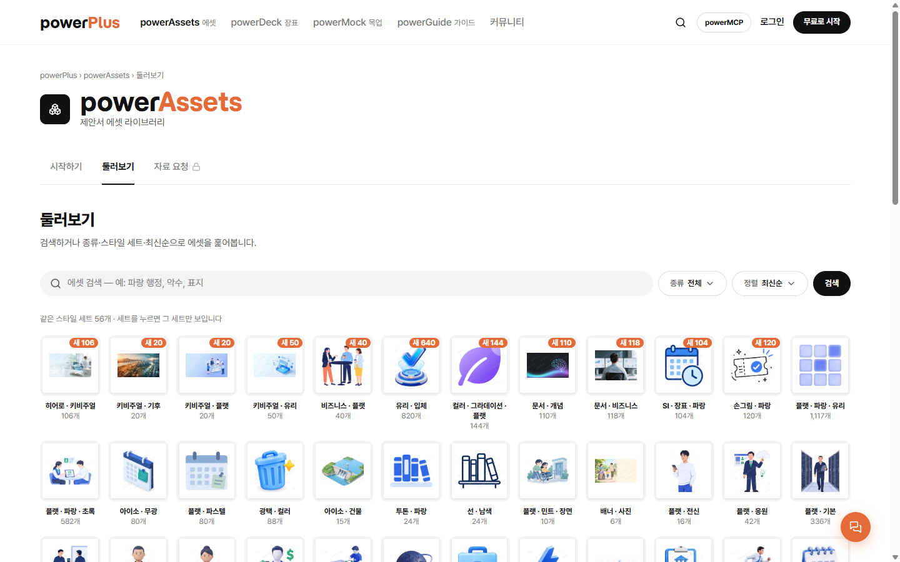 | 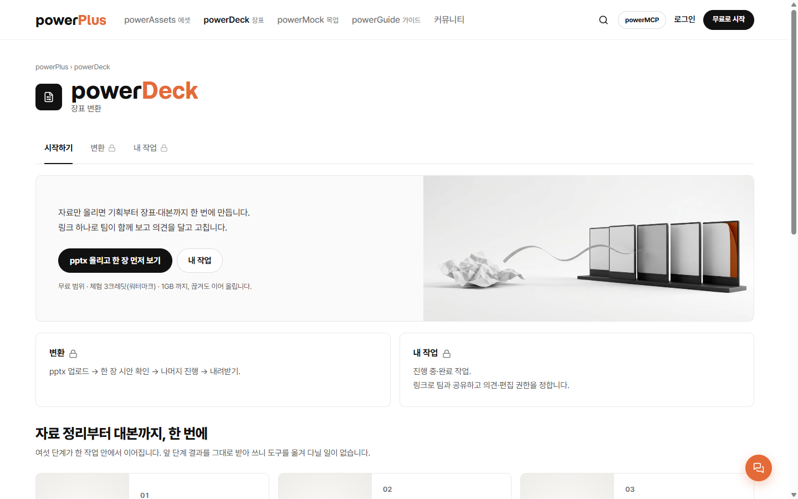 |

| powerMock — 홈페이지 목업 | powerGuide — 디자인 규칙 안내서 |
|:---:|:---:|
| 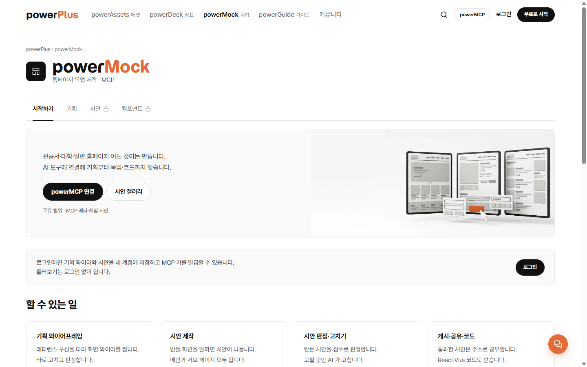 | 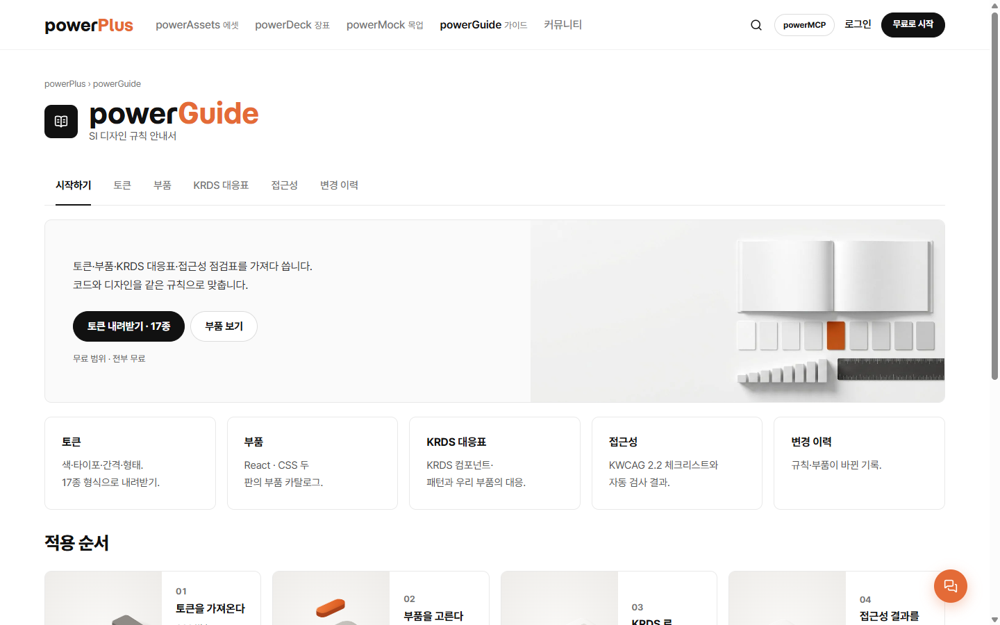 |

| powerGuide — 부품(React·Vue 코드) | powerMCP — AI 도구 연결 |
|:---:|:---:|
| 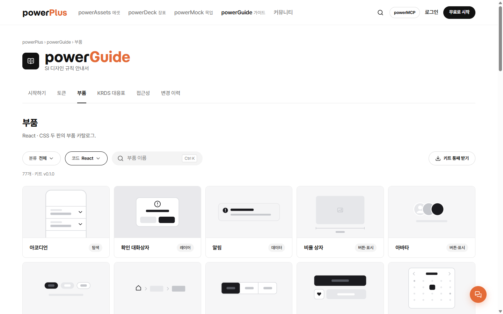 | 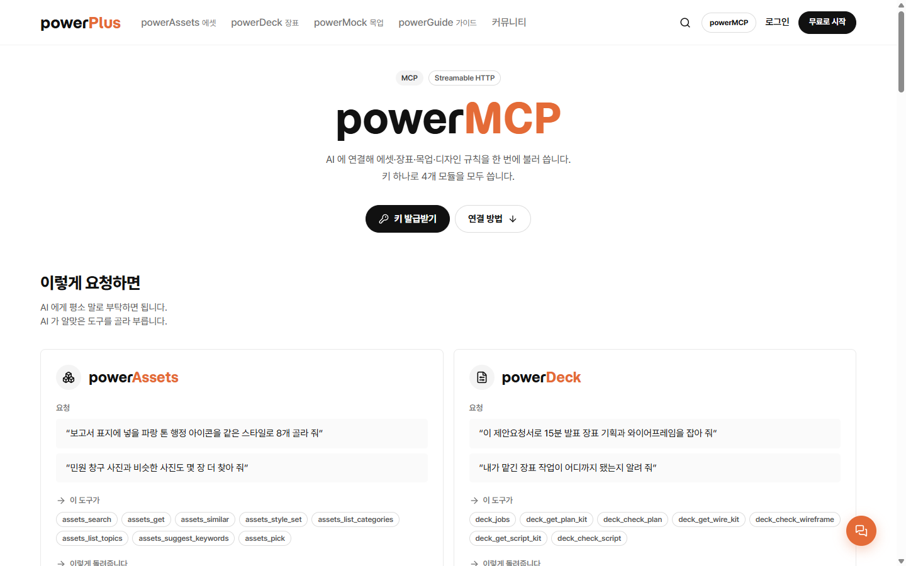 |

| MCP 연결 가이드 | 커뮤니티 |
|:---:|:---:|
| 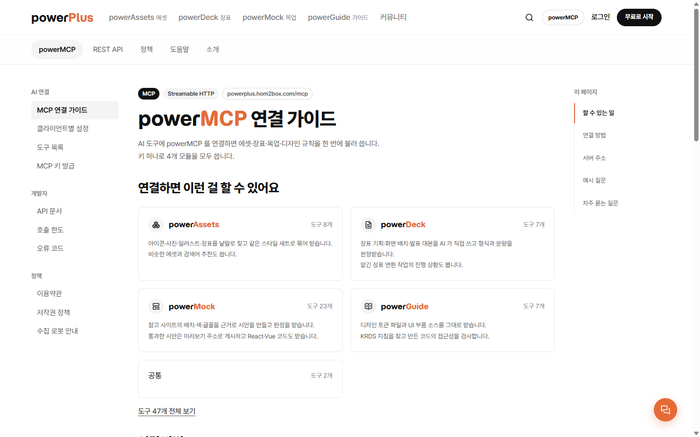 | 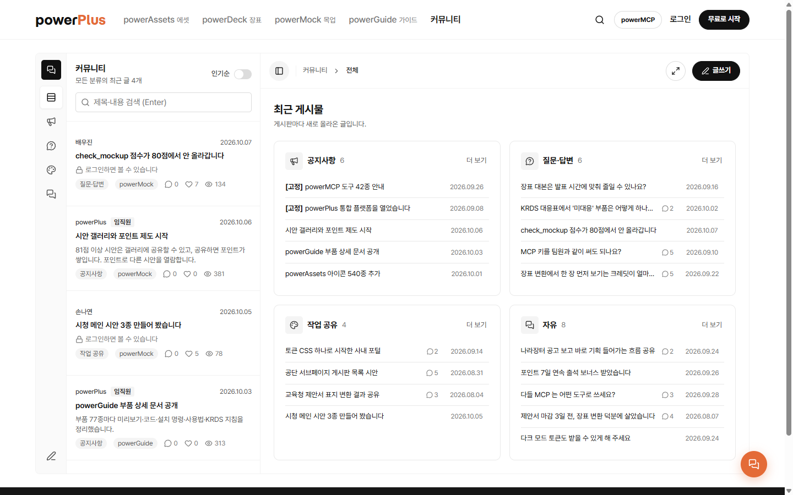 |

| 로그인 — Google·카카오·네이버·이메일 인증 |
|:---:|
| 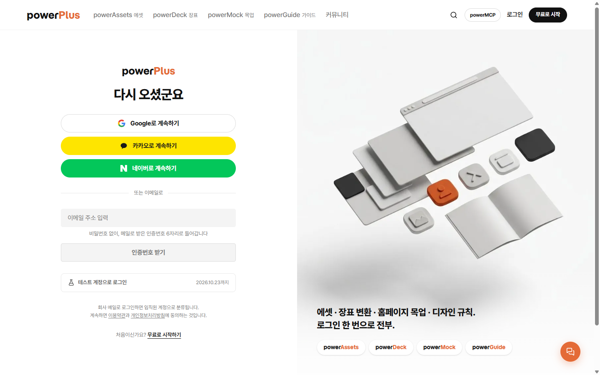 |

## 6. 관리자

### 6.1 들어가는 법
- 주소: https://powerplus.hom2box.com/admin
- 로그인한 계정에 운영 역할이 있어야 들어갈 수 있습니다. 역할이 없으면 관리자 로그인 화면에서 막힙니다.
- 오른쪽 위 「이동」 메뉴로 사이트를 새 창으로 열고, 라이트·다크 테마를 바꿀 수 있습니다.

### 6.2 역할

| 역할 | 할 수 있는 일 |
|:---:|---|
| superadmin | 한 계정 고정. 결제·구독 화면, 서버 자원 등 최상위 설정. 화면에서 부여·해제 불가 |
| admin | 사용자·역할, 포인트, 메일 서식, AI 설정, 장표 작업·과금, 시안, 콘텐츠·정책 전체 |
| curator | 에셋 등록·수정, 검색 품질, powerGuide 현황, 모듈별 개선 체크리스트 |
| support | 문의, 삭제 요청, 자료 요청 처리 |

권한 판정은 화면이 아니라 서버(`Access::can()`)가 합니다.

### 6.3 메뉴

| 묶음 | 메뉴 | 하는 일 |
|:---:|:---:|---|
| — | 대시보드 | 오늘 처리할 일, 서버·DB·엔진·AI 키·메일·MCP 연결 상태, 가입·작업 추이 |
| 요청 처리 | 문의 · 자료 요청 · 삭제요청 | 사용자가 답을 기다리는 일 — 접수·답변·처리 |
| 모듈 운영 | powerAssets › 에셋 | 등록·수정·공개 범위·세트 관리 |
| | powerAssets › 검색 통계 | 검색 수·무결과율·인기/무결과 검색어 |
| | powerDeck › 장표 작업 | 모든 사용자의 장표 작업, 엔진 상태, 대기열 |
| | powerDeck › 이력·과금 | 모델별·사용자별·일별 AI 비용 |
| | powerDeck › 참조 자료 | 기획·시안에 쓰는 참고 장표 |
| | powerMock 시안 | AI 가 만든 시안의 판정 점수·게시·갤러리 상태 |
| | powerGuide 현황 | 부품·토큰·KRDS 지침·체크리스트 자료가 제대로 실렸는지, 부품 구성과 판정 분포, MCP·REST 도구별 호출 수. 내용은 코드가 정본이라 화면에서 편집하지 않고 고칠 곳을 안내 |
| 품질 검수 | 통합 검수 | 여섯 개선 체크리스트를 한 절차로 — 다시 걸림 → 고치는 중 → 많이 걸린 순 |
| | 개선 체크리스트 | 사이트 공통 · powerAssets · powerDeck · powerMock · powerGuide · powerMCP. 같은 결함은 한 줄에 횟수·근거로 쌓임 |
| 콘텐츠 | 커뮤니티 · 도움말 · 변경 이력 · 약관·정책 · 메일 서식 | 공개 콘텐츠와 메일 문구 관리 |
| 회원·설정 | 사용자·역할 | 회원 검색, 구분(임직원·외부)·상태·역할 관리 |
| | 포인트 규칙 · 구독·결제 | 포인트 지급 규칙, 요금제(superadmin) |
| | AI 설정 | OpenRouter 연결, 챗봇 모델·하루 상한, Jev 켜기·사용처별 끄기, 30일 사용량 |

### 6.4 관리자 화면

> 아래 캡처는 테스트 계정 시점입니다. 다른 회원의 이메일·이름은 서버가 가려서 보냅니다.

| 대시보드 | 사용자·역할 |
|:---:|:---:|
| 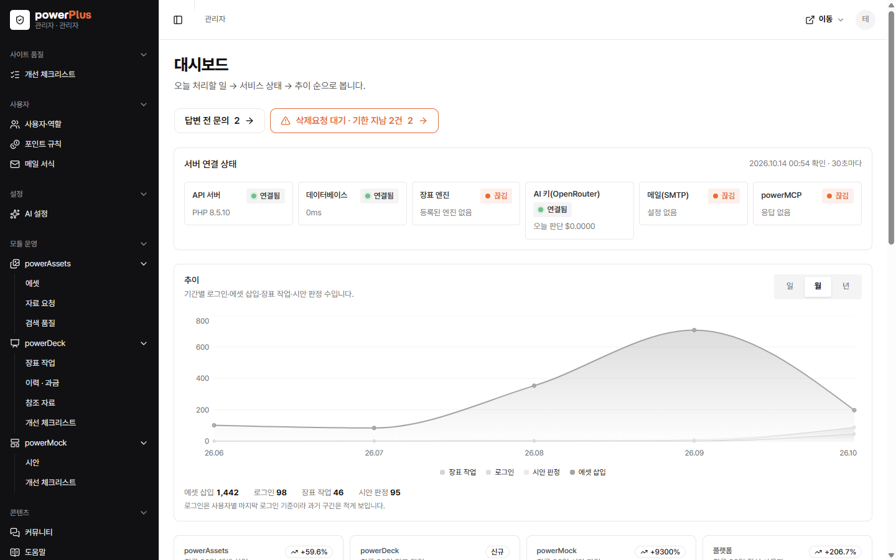 | 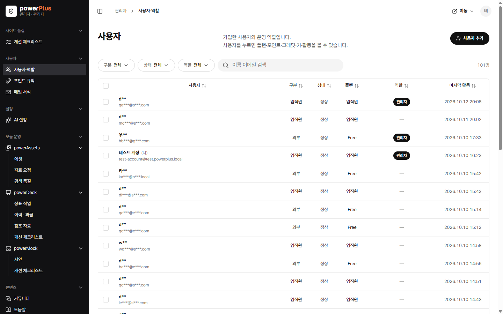 |

| AI 설정 — 챗봇·Jev | 에셋 관리 |
|:---:|:---:|
| 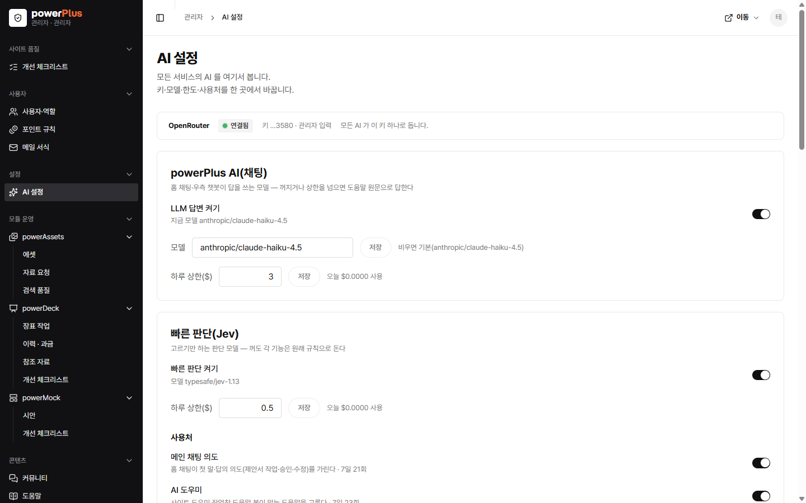 | 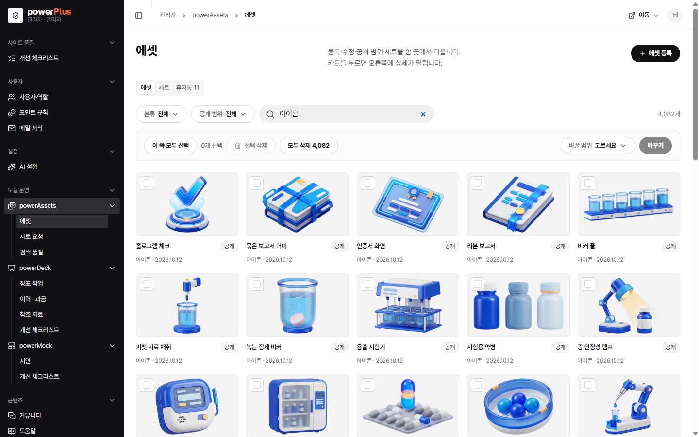 |

| 장표 작업 | 이력·과금 |
|:---:|:---:|
| 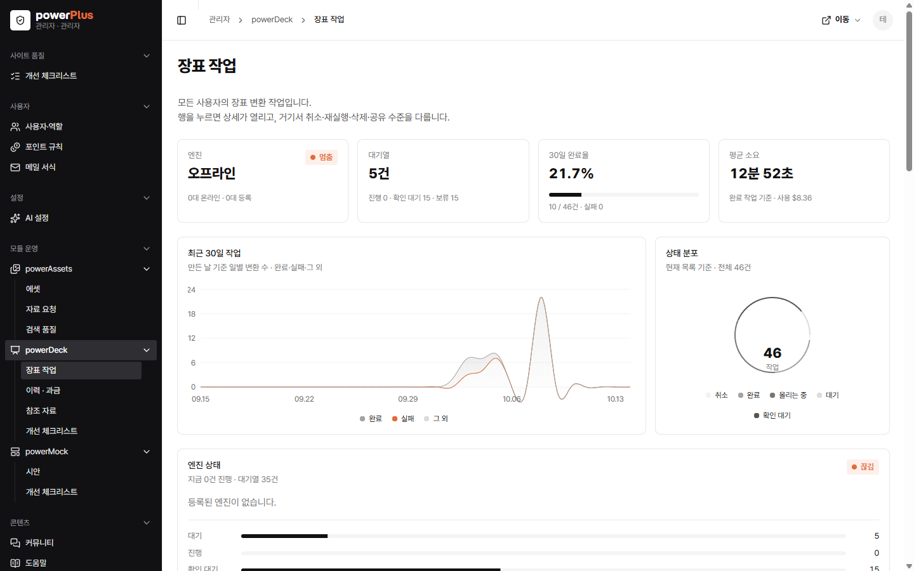 | 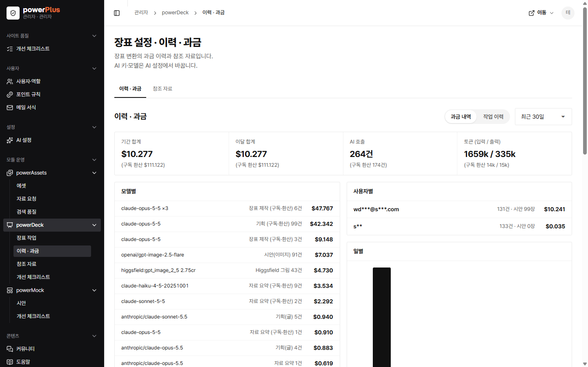 |

| 시안 판정 | 검색 품질 |
|:---:|:---:|
| 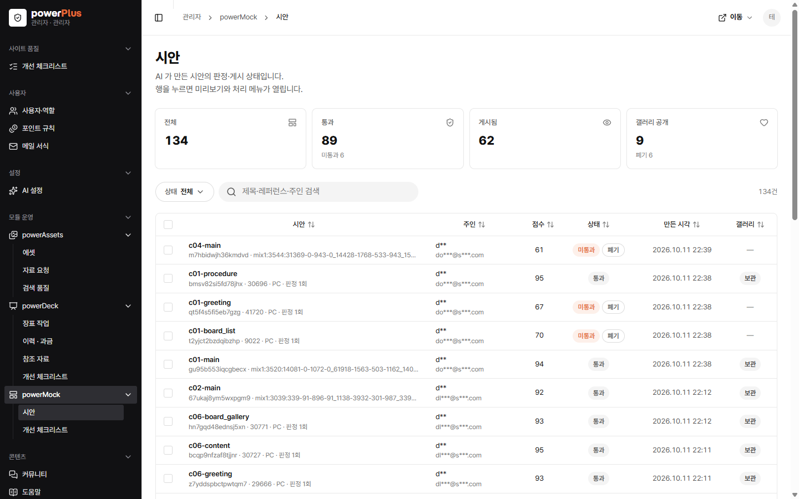 | 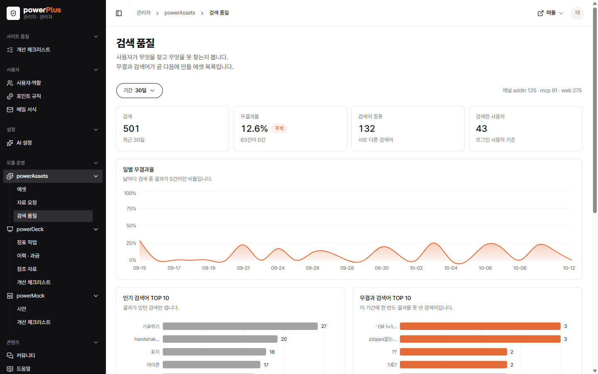 |

| powerGuide 현황 |
|:---:|
| 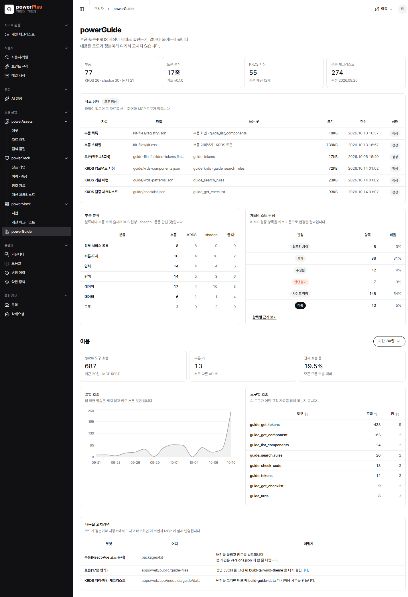 |

## 7. 심사용 테스트 계정

| 항목 | 내용 |
|:---:|---|
| 로그인 위치 | https://powerplus.hom2box.com/login 아래쪽 「테스트 계정으로 로그인」 |
| 아이디·비밀번호 | 제출 서류에 별도로 적어 드립니다(저장소에는 적지 않습니다) |
| 권한 | 관리자 화면까지 볼 수 있는 **읽기 전용** 계정 |
| 이용 기간 | 정해진 기간이 지나면 자동으로 로그인이 막힙니다 |

로그인 뒤 볼 수 있는 화면: 내 장표 작업, 내 시안, 저장한 에셋 묶음, API 키 관리, 관리자 전체 메뉴.

테스트 계정은 안전하게 볼 수만 있도록 다음처럼 묶여 있습니다.
- 저장·수정·삭제 요청은 모두 거절됩니다(로그아웃만 허용).
- 응답에 다른 회원의 이메일·이름·연락처가 있으면 가려서 보여 줍니다.
- 관리자 화면을 연 기록은 감사 로그에 남습니다.
- 비밀번호를 20번 틀리면 기간 안이라도 잠깁니다.

> **AI 챗봇은 로그인하지 않은 상태에서 써 보세요.** 테스트 계정은 읽기 전용이라 챗봇 요청도 막힙니다.

구현: [`api/src/Core/TestLogin.php`](api/src/Core/TestLogin.php) · [`api/src/Core/Mask.php`](api/src/Core/Mask.php) · 서버 CLI [`api/bin/test-account.php`](api/bin/test-account.php)

## 8. 기술 스택

| 영역 | 사용 기술 |
|:---:|---|
| 웹 화면 | React 19 · TypeScript · Vite 8 · React Router 7 · Tailwind CSS v4 · shadcn/ui |
| API | PHP 8.4 (프레임워크 없음, PDO prepared statement) · REST JSON |
| DB | MariaDB 10.11 |
| AI | OpenRouter(서버 프록시) — Claude Opus 5.5 · Claude Haiku 4.5 · Muse Spark 1.3 · gpt-image · Gemini Image · Jev |
| MCP | Node 22 · TypeScript · MCP SDK (Streamable HTTP) |
| 장표 엔진 | Python · python-pptx · LibreOffice(렌더) |
| 애드인 | Office.js PowerPoint 애드인 · Webpack 5 |
| 서버 | Ubuntu · Apache · systemd(엔진·MCP 상주) |

## 9. 시스템 구조

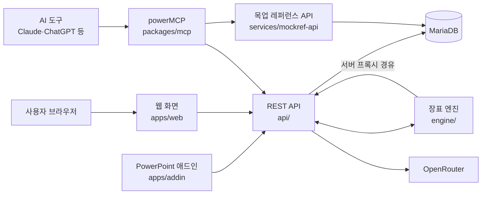

- **API 하나, MCP 하나, 키 하나** — 웹 화면과 MCP 가 같은 REST API 를 씁니다.
- **인증** — 세션 쿠키(웹) · `pp_live_` API 키(MCP·애드인) · 워커 키(엔진)를 한 미들웨어가 받아 같은 사용자 객체(`Actor`)로 만듭니다.
- **장표 엔진** — 서버는 작업 대기열만 두고, 엔진이 작업을 끌어가 처리한 뒤 결과를 올립니다.
- **DB 설계** — [`docs/db-design.md`](docs/db-design.md) 를 먼저 쓰고 검토한 뒤 [`db/schema.sql`](db/schema.sql) 과 증분 마이그레이션으로 옮겼습니다.

자세한 설계는 [`docs/ARCHITECTURE.md`](docs/ARCHITECTURE.md), 기획은 [`docs/PLAN.md`](docs/PLAN.md) 에 있습니다.

## 10. 폴더 구조

pnpm 모노레포입니다. 화면(`apps`)·서버(`api`·`services`)·공용 패키지(`packages`)·장표 엔진(`engine`)·DB(`db`)를 한 저장소에 둡니다.

### 10.1 최상위

```
powerplus-platform/
├─ apps/          사용자가 쓰는 프로그램 — 웹 화면, PowerPoint 애드인
├─ api/           플랫폼 REST API (PHP) — 계정·권한·모듈 기능·관리자·챗봇·AI 호출
├─ services/      powerMock 레퍼런스 API (PHP) — 관공서 화면 데이터·목업 조립
├─ packages/      공용 패키지 — powerMCP 서버, powerGuide 부품 키트, 공용 분류표
├─ engine/        powerDeck 장표 엔진 (Python) — 기획·시안·pptx 제작·마감
├─ db/            스키마·마이그레이션·옛 서비스 데이터 이관
├─ scripts/       배포·배포 전 자가 검사·백업·빌드 보조
├─ docs/          기획·설계·점검 보고서·README 캡처
├─ design/        디자인 샘플 에셋
├─ README.md · LICENSE · CLAUDE.md(개발 지침)
└─ package.json · pnpm-workspace.yaml · .env.example
```

### 10.2 모듈별 코드 위치

| 모듈 | 화면 | API | 그 밖 |
|:---:|---|---|---|
| 공통(계정·권한) | `apps/web/app/routes` (login·account) | `api/src/Core` · `api/routes/core.php` | `db/schema.sql` |
| 챗봇 | `apps/web/app/components/chat` | `api/routes/chat.php` · `assist.php` | `api/src/Core` 의 Jev·Llm·Concierge |
| powerAssets | `apps/web/app/modules/assets` | `api/src/Assets` · `api/routes/assets.php` · `addin.php` | `apps/addin` |
| powerDeck | `apps/web/app/modules/deck` | `api/src/Deck` · `api/routes/deck*.php` | `engine` |
| powerMock | `apps/web/app/modules/mock` | `api/src/Mock` · `api/routes/mock*.php` | `services/mockref-api` · `packages/mcp/src/qa` |
| powerGuide | `apps/web/app/modules/guide` | `api/src/Guide` · `api/routes/guide.php` | `packages/kit` |
| powerMCP | `apps/web/app/routes/powermcp.tsx` · `docs.tsx` | 각 모듈 API 를 그대로 씀 | `packages/mcp` |
| 관리자 | `apps/web/app/routes/admin-*.tsx` | `api/routes/admin*.php` | `apps/web/app/components/admin` |

### 10.3 주요 폴더 상세

**apps/**
```
apps/
├─ web/                      웹 화면 (React Router 7 SPA · Vite)
│  ├─ app/
│  │  ├─ routes/             화면 하나 = 파일 하나 (홈·모듈·계정·관리자·문서·약관)
│  │  ├─ modules/            모듈 화면 — assets · deck · mock · guide
│  │  ├─ components/
│  │  │  ├─ ui/              shadcn/ui 원본 부품
│  │  │  ├─ hb/              자체 공통 부품 (버튼·태그·문장 분리·테스트 로그인 …)
│  │  │  ├─ chat/            메인 챗봇
│  │  │  └─ admin/           관리자 공통 (제목·정렬 머리)
│  │  ├─ lib/                API 호출·로그인 상태·관리자 API·페이지 제목
│  │  ├─ hooks/ · data/ · styles/
│  │  └─ routes.ts           주소 → 화면 연결표
│  └─ public/                정적 파일 — powerGuide 키트·토큰 산출물 (kit-files · guide-files)
└─ addin/                    PowerPoint 애드인 (Office.js · Webpack)
   ├─ src/taskpane/          작업창 화면
   └─ installer/             설치 마법사 (WebView2)
```

**api/ · services/**
```
api/
├─ public/index.php          진입점 — routes/*.php 를 읽어 경로 등록
├─ routes/                   경로 묶음 (core · chat · assets · deck · mock · guide · admin* …)
├─ src/
│  ├─ Core/                  인증·권한(Access)·감사 로그·메일·포인트·가림(Mask)·Jev·powerLLM
│  ├─ Assets/                검색(동의어·오타 교정)·문맥 고르기
│  ├─ Deck/                  AI 키·모델·예산(AiKeys)·와이어 배치·대본·개선 체크리스트
│  ├─ Mock/                  와이어 초안·다듬기·개선 체크리스트
│  ├─ Guide/                 부품·토큰·KRDS 자료 읽기·코드 점검
│  └─ Site/                  사이트 품질 체크리스트
├─ data/                    서버가 읽는 자료 (KRDS 사본 data/guide 는 배포 때 build-guide-data 가 만듦)
├─ bin/                      서버 CLI (테스트 계정·정리 작업)
└─ config.example.php        설정 예시 (실제 config.php 는 저장소에 없음)

services/mockref-api/        powerMock 레퍼런스 API — 수집 화면 분석·재현 묶음·섹션 코드·시안 보관
```

**packages/ · engine/**
```
packages/
├─ mcp/                      powerMCP 서버 (Node · MCP SDK, 도구 47개)
│  └─ src/
│     ├─ index.ts            도구 정의
│     ├─ tools/              모듈별 도구 묶음
│     └─ qa/                 시안 판정 — 실제 렌더·게이트·동작·대비 검사
├─ kit/                      powerGuide 부품 키트
│  ├─ react/ · vue/ · css/   같은 부품의 React·Vue·CSS 판
│  ├─ krds/ · checklist/     KRDS 대응·검증 체크리스트 판정
│  └─ versions.json          키트 버전 기록
└─ shared/                   모듈 공용 분류표·스키마

engine/                      powerDeck 장표 엔진 (Python)
├─ worker.py                 작업 대기열에서 일을 가져와 단계 실행
├─ design.py                 자료 요약·기획·와이어·시안
├─ or_agent.py · or_models.py                pptx 제작 에이전트 · 모델 능력표
├─ sizeguard.py · vcenter.py · finalize.py …  결정적 마감 보정
├─ known_errors.json         알려진 장표 오류 — 지침·체크리스트·회귀 시험의 단일 원천
├─ pipeline/                 장표 정리 단계 (서체·색·아이콘·도식·줄바꿈 …)
├─ skill/si-deck/            장표 마감 규칙과 참고 자료
├─ reference-guide/          참고 장표에서 배운 디자인 지침
├─ prompt*.md                단계별 AI 지시문
└─ tests/                    회귀 시험
```

**db/ · scripts/ · docs/**
```
db/
├─ schema.sql                전체 스키마 (멱등)
├─ migrations/               증분 마이그레이션 (번호 순)
├─ scripts/                  migrate · seed
└─ migrate-legacy/           기존 서비스 4개 → 새 DB 이관

scripts/
├─ deploy.sh                 웹·API 배포 (첫 줄에서 preflight.sh 자가 검사)
├─ deploy-engine.sh · deploy-mcp.sh · deploy-mockref.sh   엔진·MCP·레퍼런스 API 따로 배포
├─ preflight.sh · preflight/ 배포 전 자가 검사
├─ db-backup*.sh · db-restore-drill.sh                     백업·복구 훈련
├─ build-*.mjs               powerGuide 자료·Tailwind 테마·설치 프로그램 빌드
└─ leak-audit.mjs · responsive-audit.mjs                   권한 누출·반응형 점검

docs/
├─ PLAN.md · ARCHITECTURE.md · db-design.md                기획·설계
├─ 오류-재발방지-체크리스트.md · 장표-기본규칙-오류체크리스트.md   재발 방지 기록
├─ *-테스트보고서-*.md · 사이트-품질-*.md                   기능·MCP·사이트 품질 점검 결과
├─ inventory/                기존 저장소 4개 기능 인벤토리
├─ rfp-분석결과/              공개 입찰 공고 분석
└─ screenshots/              README 화면 캡처
```

## 11. 로컬 실행

필요한 것: Node 22.12 이상 · pnpm 11 · PHP 8.4 · MariaDB 10.11

```bash
# 1) 의존성
pnpm install

# 2) DB 와 API 설정
cp api/config.example.php api/config.php     # DB 접속 정보 입력
pnpm db:migrate                               # 스키마 + 마이그레이션 적용
pnpm db:seed                                  # 기본 데이터

# 3) API 서버
php -S 127.0.0.1:8090 -t api/public
curl http://127.0.0.1:8090/api/v1/health      # "db": true 가 나오면 정상

# 4) 웹 화면
pnpm dev
```

- 로컬 개발용 로그인: `GET /api/v1/auth/dev?email=…` (debug 설정이고 127.0.0.1 에서만 동작)
- 이메일 인증번호는 debug 설정이면 응답의 `dev_code` 로 받습니다.
- AI 기능은 관리자 AI 설정에 OpenRouter 키를 넣어야 동작합니다. 키가 없으면 규칙 기반으로만 돕니다.
- 장표 엔진은 [`engine/README.md`](engine/README.md), MCP 는 `/docs` 화면을 참고하세요.

## 12. 공개본 안내

이 저장소는 비공개 개발 저장소에서 걸러 낸 스냅샷입니다.
다음 항목은 공개본에서 빼거나 바꿨습니다.

- 발주처 제안서 실물(장표 엔진 학습용 기준 이미지·회고 문서)은 뺐고, 문서 속 기관명은 「OO시」로 바꿨습니다.
- 운영 서버 접속 정보·개인 계정·개인 PC 경로는 환경 변수나 예시 값으로 바꿨습니다.
- 지자체 목록 데이터와 RFP 분석 문서의 기관명은 공개된 공공 정보라 그대로 두었습니다.

## 13. 라이선스

Copyright (c) 2026 ㈜솔리데오. All rights reserved.
심사·검토 목적으로만 공개합니다. 자세한 내용은 [LICENSE](LICENSE) 를 보세요.
