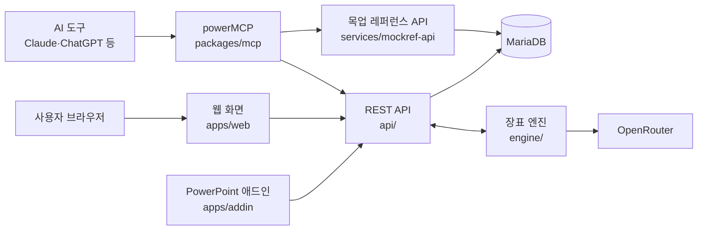

# powerPlus — SI 실무자의 올인원 플랫폼

> 제안서 에셋, 장표 변환, 홈페이지 목업, 디자인 규칙을 로그인 한 번으로 씁니다.
> AI 도구(Claude·ChatGPT 등)에서는 MCP 하나로 같은 기능을 그대로 부릅니다.

| 데모 | 주소 |
|:---:|---|
| 서비스 | https://powerplus.hom2box.com |
| MCP 연결 가이드 | https://powerplus.hom2box.com/docs |
| 상태 확인(API) | https://powerplus.hom2box.com/api/v1/health |


---

## 목차
1. [왜 만들었나](#1-왜-만들었나)
2. [다섯 개 모듈](#2-다섯-개-모듈)
3. [화면](#3-화면)
4. [심사용 테스트 계정](#4-심사용-테스트-계정)
5. [기술 스택](#5-기술-스택)
6. [구조](#6-구조)
7. [폴더 구조](#7-폴더-구조)
8. [로컬 실행](#8-로컬-실행)
9. [공개본 안내](#9-공개본-안내)
10. [라이선스](#10-라이선스)

---

## 1. 왜 만들었나

SI 제안·구축 실무는 같은 일을 매번 처음부터 합니다.

- 제안서 장표에 넣을 아이콘·사진을 찾느라 시간을 씁니다.
- 여러 사람이 만든 장표의 서체·색·여백이 제각각입니다.
- 공공기관 홈페이지 목업을 만들 때마다 레퍼런스를 다시 모읍니다.
- 디자인 규칙과 접근성(KRDS·KWCAG) 기준이 문서마다 흩어져 있습니다.

powerPlus 는 흩어져 있던 사내 도구 네 개를 한 플랫폼으로 합쳤습니다.
계정·권한·공개 범위를 하나로 묶었고, 같은 기능을 웹 화면과 MCP 양쪽에서 씁니다.

## 2. 다섯 개 모듈

| 모듈 | 하는 일 | 주소 |
|:---:|---|:---:|
| **powerAssets** | 아이콘·일러스트·사진·장표 에셋 라이브러리. 검색, 같은 톤 세트 추천, PowerPoint 애드인으로 바로 삽입 | `/assets` |
| **powerDeck** | 자료(pptx·문서)를 올리면 기획 → 와이어프레임 → 시안 → 장표 제작까지 한 흐름으로 진행 | `/deck` |
| **powerMock** | 국내 공공·대학 홈페이지 실제 화면에서 뽑은 레퍼런스로 홈페이지 목업과 화면 코드를 만듦 | `/mock` |
| **powerGuide** | 디자인 토큰·React/Vue 부품·KRDS 대응표·접근성 점검표를 한 곳에서 제공 | `/guide` |
| **powerMCP** | 위 네 모듈을 AI 도구에서 부르는 MCP 서버 하나(도구 47개, 키 하나) | `/powermcp` |

모든 콘텐츠에는 공개 범위가 붙습니다(사내 전용 → 파트너 → 유료 → 무료 → 공개).
화면에서 숨기는 것이 아니라 서버가 한 함수(`Access::can()`)로 판정합니다.

## 3. 화면

| powerAssets — 에셋 둘러보기 | powerDeck — 장표 변환 |
|:---:|:---:|
|  |  |

| powerMock — 홈페이지 목업 | powerGuide — 디자인 규칙 안내서 |
|:---:|:---:|
|  |  |

| powerGuide — 부품(React·Vue 코드) | powerMCP — AI 도구 연결 |
|:---:|:---:|
|  |  |

| MCP 연결 가이드 | 커뮤니티 |
|:---:|:---:|
|  |  |

| 로그인 — Google·카카오·네이버·이메일 인증 |
|:---:|
|  |

## 4. 심사용 테스트 계정

| 항목 | 내용 |
|:---:|---|
| 로그인 위치 | https://powerplus.hom2box.com/login 아래쪽 「테스트 계정으로 로그인」 |
| 아이디·비밀번호 | 제출 서류에 별도로 적어 드립니다(저장소에는 적지 않습니다) |
| 권한 | 관리자 화면까지 볼 수 있는 **읽기 전용** 계정 |
| 이용 기간 | 정해진 기간이 지나면 자동으로 로그인이 막힙니다 |

테스트 계정은 안전하게 볼 수만 있도록 다음처럼 묶여 있습니다.

- 저장·수정·삭제 요청은 모두 거절됩니다(로그아웃만 허용).
- 응답에 다른 회원의 이메일·이름·연락처가 있으면 가려서 보여 줍니다.
- 관리자 화면을 연 기록은 감사 로그에 남습니다.
- 비밀번호를 20번 틀리면 기간 안이라도 잠깁니다.

구현: [`api/src/Core/TestLogin.php`](api/src/Core/TestLogin.php) · 서버 CLI [`api/bin/test-account.php`](api/bin/test-account.php)

로그인하면 볼 수 있는 화면:
내 장표 작업, 내 시안(powerMock), 저장한 에셋 묶음, API 키 관리, 관리자(회원·에셋·장표 작업·메일·정책·점검표).

## 5. 기술 스택

| 영역 | 사용 기술 |
|:---:|---|
| 웹 화면 | React 19 · TypeScript · Vite 8 · React Router 7 · Tailwind CSS v4 · shadcn/ui |
| API | PHP 8.4 (프레임워크 없음, PDO prepared statement) · REST JSON |
| DB | MariaDB 10.11 |
| MCP | Node 22 · TypeScript · MCP SDK (Streamable HTTP) |
| 장표 엔진 | Python · python-pptx · LibreOffice(렌더) · OpenRouter(글 생성) |
| 애드인 | Office.js PowerPoint 애드인 · Webpack 5 |
| 서버 | Ubuntu · Apache · systemd(엔진·MCP 상주) |

## 6. 구조



- **API 하나, MCP 하나, 키 하나** — 웹 화면과 MCP 가 같은 REST API 를 씁니다.
- **인증** — 세션 쿠키(웹) · `pp_live_` API 키(MCP·애드인) · 워커 키(엔진)를 한 미들웨어가 받아 같은 사용자 객체(`Actor`)로 만듭니다.
- **장표 엔진** — 서버는 작업 대기열만 두고, 엔진이 작업을 끌어가 처리한 뒤 결과를 올립니다(엔진 쪽 열린 포트 없음).
- **DB 설계** — [`docs/db-design.md`](docs/db-design.md) 를 먼저 쓰고 검토한 뒤 [`db/schema.sql`](db/schema.sql) 과 증분 마이그레이션으로 옮겼습니다.

자세한 설계는 [`docs/ARCHITECTURE.md`](docs/ARCHITECTURE.md), 기획은 [`docs/PLAN.md`](docs/PLAN.md) 에 있습니다.

## 7. 폴더 구조

```
powerplus-platform/
├─ apps/
│  ├─ web/                  웹 화면 (React Router 7 SPA)
│  │  └─ app/
│  │     ├─ routes/         화면 하나 = 파일 하나 (홈·모듈·계정·관리자·문서)
│  │     ├─ modules/        모듈별 화면 (assets · deck · mock · guide)
│  │     ├─ components/     공통 부품 (shadcn/ui + 자체 hb 부품)
│  │     └─ lib/            API 호출·권한·페이지 제목 등
│  └─ addin/                PowerPoint 애드인 + 설치 프로그램
├─ api/                     REST API (PHP 8)
│  ├─ public/index.php      진입점
│  ├─ routes/               모듈별 경로 (core · assets · deck · mock · guide · admin …)
│  ├─ src/Core/             인증·권한·감사 로그·메일·포인트 등 공통 기능
│  └─ bin/                  서버 CLI (테스트 계정·정리 작업)
├─ services/
│  └─ mockref-api/          powerMock 레퍼런스 API (수집 화면 분석·목업 조립·판정)
├─ packages/
│  ├─ mcp/                  powerMCP 서버 (도구 47개)
│  ├─ kit/                  powerGuide 부품 키트 (CSS · React · Vue · KRDS · 점검표)
│  └─ shared/               모듈이 함께 쓰는 분류표·타입
├─ engine/                  powerDeck 장표 엔진 (Python)
│  ├─ pipeline/             장표 정리 단계 (서체·색·아이콘·도식·줄바꿈 …)
│  └─ skill/                장표 마감 규칙과 참고 자료
├─ db/
│  ├─ schema.sql            전체 스키마 (멱등)
│  ├─ migrations/           증분 마이그레이션
│  ├─ scripts/              migrate · seed
│  └─ migrate-legacy/       기존 서비스 4개 → 새 DB 이관 스크립트
├─ design/                  디자인 샘플 에셋
├─ docs/                    기획·설계·점검 보고서·화면 캡처
└─ scripts/                 배포·배포 전 자가 검사·백업·빌드 보조
```

## 8. 로컬 실행

필요한 것: Node 22.12 이상 · pnpm 11 · PHP 8.4 · MariaDB 10.11

```bash
# 1) 의존성
pnpm install

# 2) DB 와 API 설정
cp api/config.example.php api/config.php     # DB 접속 정보 입력
pnpm db:migrate                               # 스키마 + 마이그레이션 적용
pnpm db:seed                                  # 기본 데이터

# 3) API 서버
php -S 127.0.0.1:8090 -t api/public
curl http://127.0.0.1:8090/api/v1/health      # "db": true 가 나오면 정상

# 4) 웹 화면
pnpm dev
```

- 로컬 개발용 로그인: `GET /api/v1/auth/dev?email=…` (debug 설정이고 127.0.0.1 에서만 동작)
- 이메일 인증번호는 debug 설정이면 응답의 `dev_code` 로 받습니다.
- 장표 엔진은 [`engine/README.md`](engine/README.md), MCP 는 `/docs` 화면을 참고하세요.

## 9. 공개본 안내

이 저장소는 비공개 개발 저장소에서 걸러 낸 스냅샷입니다.
다음 항목은 공개본에서 빼거나 바꿨습니다.

- 발주처 제안서 실물(장표 엔진 학습용 기준 이미지·회고 문서)은 뺐고, 문서 속 기관명은 「OO시」로 바꿨습니다.
- 운영 서버 접속 정보·개인 계정·개인 PC 경로는 환경 변수나 예시 값으로 바꿨습니다.
- 지자체 목록 데이터와 RFP 분석 문서의 기관명은 공개된 공공 정보라 그대로 두었습니다.

## 10. 라이선스

Copyright (c) 2026 ㈜솔리데오. All rights reserved.
심사·검토 목적으로만 공개합니다. 자세한 내용은 [LICENSE](LICENSE) 를 보세요.
